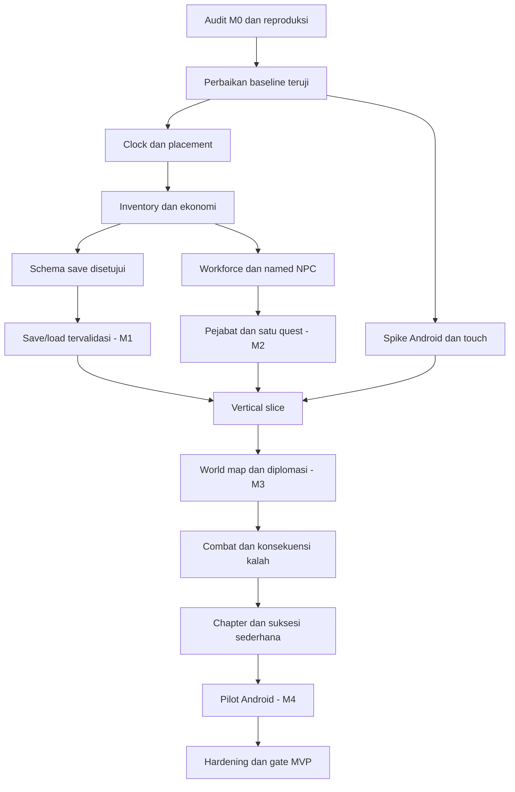

# Execution Blueprint v0.1

Status: backlog usulan, **belum otorisasi implementasi**. Roadmap resmi tetap [ROADMAP.md](ROADMAP.md). Hasil pekerjaan sekarang hanya paket dokumentasi.

Catatan review v1.1: [PRD](PRD.md) tetap DRAFT; [Decision Register](DECISION_REGISTER.md) mencatat penerimaan prinsip dan pertanyaan prioritas O01–O04. Diagram/gate di bawah adalah urutan usulan, bukan approval isi pilot/MVP. Arah Android dini diterima secara prinsip, perangkat/pelaksanaan masih OPEN. A02 gameplay **NOT TESTED**; task card read-only terbaru ada di PRD §19. Kode/refactor belum diotorisasi.

## Dependency graph dan gate milestone

Spike Android awal diterima sebagai arah secara prinsip; O04 menetapkan perangkat dan rencana sebelum pelaksanaan. Offline progression baru sesudah save, ekonomi, lifecycle dan aturan offline disetujui. Siege, intelijen, logistik kompleks dan produksi berkualitas tetap visi tertelusur pada PRD §7 dan roadmap, tanpa komitmen scope pilot/MVP.

| Gate | Acceptance criteria | Manual test minimum |
|---|---|---|
| M0 dibuka kembali | Placement dan tombol waktu terbukti bekerja, penyebab bug terdokumentasi | Pilih setiap jenis bangunan; petak kosong/terisi/luar; klik UI; Pause/1/2/3 |
| M1 | Tidak ada double-charge; stok konsisten; save round-trip; kamera tidak merusak pemilihan cell | Bangun, pan/zoom, save, tutup/buka, load; bandingkan stok, waktu dan posisi |
| M2 / slice | Pekerja memengaruhi produksi; satu pejabat berbatas wewenang; dua hasil quest; ada pemulihan kekurangan | Ubah prioritas, kosongkan pekerja, pilih dua jalur pada sesi terpisah, reload setelah pilihan |
| M3 | Hubungan tetangga dan battle terbatas menyimpan konsekuensi sekali | Menang, retreat, kalah; load masing-masing; permainan tetap dapat diteruskan |
| M4 / pilot | Satu chapter selesai, transisi pewaris teruji, UI touch dan save recovery bekerja di perangkat | Chapter normal/alternatif, suspend/resume, load backup, sesi perangkat 15 menit |
| MVP | Tidak ada blocker penerimaan; konten, performa dan distribusi disetujui | Pemain baru memainkan tutorial tanpa bantuan; pemeriksaan build kandidat oleh Director |

## Backlog siklus pertama

Siklus berbasis hasil, bukan janji sprint dua minggu. Ambil satu item aktif. Task P0 dapat ditugaskan setelah pemilik meminta audit; item lain menunggu bukti atau keputusan prasyarat.

| ID | Tugas / pemilik | Prasyarat | Hasil penerimaan |
|---|---|---|---|
| P0 | Audit baseline / QA + Lead | Repo tersedia | Versi engine, commit, reproduksi, expected/actual dan temuan berprioritas |
| P1 | Perbaiki satu blocker teratas / pemilik modul | P0 menunjukkan sebab | Skenario gagal kini lolos; tidak memperluas fitur |
| P2 | Ratifikasi scope dan core loop / Director + Lead | Paket planning + P0 | Keputusan diterima/ditunda tercatat; GDD minimum |
| P3 | Ekstraksi clock / Simulation | Baseline lolos dan proposal diterima | State setelah N tick identik pada 1×/2×/3×; pause tidak maju |
| P4 | Grid/placement / World | Kontrak biaya/occupancy | Petak dan biaya berubah atomik; invalid tidak bermutasi |
| P5 | Inventori dan ekonomi / Simulation | Aturan pemulihan disetujui | Ledger dapat dihitung manual; tanpa render memberi hasil sama |
| P6 | Spesifikasi save lalu persistence / Lead | State stabil; SAVE_FORMAT disahkan | Round-trip, corrupted file, unknown version dan backup teruji |

## Prompt audit yang siap digunakan

> Bertindak sebagai QA/Tech Lead. Baca AGENTS.md, README, DECISIONS, ROADMAP, dan paket planning. Audit prototype tanpa refactor atau menambah fitur. Catat Git status/commit dan versi executable Godot lokal. Jalankan import/parser, lalu reproduksi F5 bila kontrol aplikasi tersedia. Uji pilihan Rumah/Sawah/Lumbung, klik petak kosong/terisi/luar, biaya tidak cukup, klik HUD, Pause/1×/2×/3×, dan perubahan pangan/hari. Gunakan nilai awal kode sebagai expected, bukan aturan desain baru. Buat docs/AUDIT_REPORT.md berisi langkah, expected/actual, log, temuan severity, dugaan versus sebab terbukti, serta patch terkecil yang direkomendasikan. File yang boleh diubah hanya laporan audit; jangan memperbaiki source pada tugas ini. Bila GUI tidak dapat diuji, tandai belum diuji dan minta pemilik menjalankan skenario F5. Jangan menyatakan M0 selesai dari parser saja.

## Prompt perbaikan sesudah audit

> Perbaiki hanya bug [ID dari AUDIT_REPORT] dengan reproduksi [langkah]. Allowed files: [ditetapkan Lead berdasarkan sebab]. Pertahankan aturan gameplay dan aset. Acceptance: [expected dari audit] tercapai, input UI tidak memicu placement, dan skenario baseline terkait tetap lolos. Jalankan parser dan uji reproduksi. Laporkan diff, expected/actual, keterbatasan dan checkpoint. Jika sebab memerlukan perubahan gameplay atau arsitektur substansial, siapkan rekomendasi konkret sebelum menerapkannya.

## Persiapan Android dan rilis

Spike pertama membuktikan export template yang cocok, pemasangan di perangkat, renderer, input touch, landscape dan lifecycle. Jangan menganggap direktori export_templates membuktikan template terpasang. Catat perangkat/OS, versi engine/template, cara build, dan hasil aktual. Signing key milik pemilik; jangan commit secret atau memasukkannya ke log.

Menjelang MVP, buat checklist distribusi dari sumber resmi terkini: target API, package identity, signing/backup key, rating konten, sasaran usia, formulir data dan privasi yang sesuai perilaku aktual, serta jalur pengujian toko. Dokumen ini tidak menyatakan persyaratan Play Store atau AdMob saat ini. Kajian kebijakan dilakukan saat rilis direncanakan. Ads, analytics, payment dan SDK lain tetap memerlukan persetujuan terpisah.

## Bukti dan pelaporan

Format laporan tiap milestone: commit/checkpoint; exact changed files; engine/perangkat; perintah uji; hasil pass/fail/not-tested; langkah manual dan expected/actual; known limitations; keputusan tertunda; satu next step. Simpan kegagalan sebagai bukti yang perlu ditindaklanjuti. Jangan melabeli roadmap selesai berdasarkan jumlah file atau dokumen yang dibuat.
