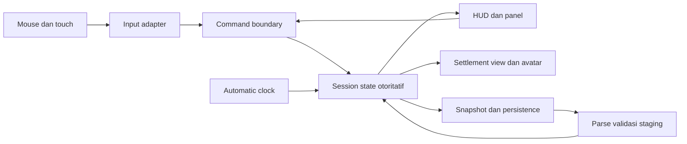

# Satriya Village — Technical Design Document v0.1

Tanggal: 26 Oktober 2026. **DRAFT / PROPOSED**, berbasis [PRD v1.1](PRD.md), [Master GDD](MASTER_GDD.md) dan [Decision Register](DECISION_REGISTER.md). Ini rancangan modular Godot 4.7.2 Standard + typed GDScript, bukan struktur yang sudah diimplementasikan atau approval arsitektur. Tidak ada package/SDK baru yang diusulkan.

## 1. Baseline dan strategi migrasi

Baseline dokumentasi saat tugas dimulai: commit `3e014aa`. `scenes/main.tscn` menjalankan `scripts/main.gd`; source mencampur HUD, input, rendering, waktu dan ekonomi. NPC yang digambar dekoratif. A02/M0 **NOT TESTED**. Versi executable, F5 dan Android belum dibuktikan oleh TDD.

Selama editorial terdeteksi perubahan working tree pada main serta file simulasi/tes dari luar pekerjaan dokumentasi ini. Snapshot di atas tetap historis; tidak dianggap audit atau penerimaan arsitektur perubahan tersebut. Audit berikut mencatat commit/diff/source aktual sebelum memilih expected; jangan melakukan reset terhadap perubahan pengguna.

Urutan: [audit M0](M0_AUDIT_PLAN.md) tanpa source edit → jika perlu, fix sempit dengan expected yang sama → kontrak fitur ditinjau → ekstraksi satu tanggung jawab → regression → tambahan perilaku terpisah. Jangan mengganti scene/root atau seluruh monolith sekaligus. Clock/grid/inventory model boleh diekstrak bertahap hanya setelah gate terkait siap. Target folder di bawah dibuat saat dibutuhkan, bukan scaffolding massal.

## 2. Batas model, command dan presentasi

Definisi bangunan/quest/karakter terpisah dari state runtime. Model tidak menyimpan Node, koordinat layar, atau HUD. Resource bertipe untuk definisi dan objek model ringan adalah rekomendasi awal; format authoring dipilih dalam kontrak data. Hindari ECS, bus global generik, banyak autoload dan threading sebelum ada kebutuhan terukur.

Satu session memiliki state otoritatif. Commands divalidasi dan diproses berurutan sebagai transaksi. Result memuat success/reason dan ID terkait. Signal hasil hanya memberitahu view; subscriber tidak menerapkan efek ekonomi ulang. Simpan `state_revision` yang bertambah pada transaksi/tick sehingga perubahan command saat pause dapat dibedakan meskipun tick tetap.

## 3. Ownership dan kontrak modul usulan

Nama/path berikut target, belum file implementasi. Integrator memiliki main scene, project settings dan perubahan kontrak bersama.

| Modul / target | Input → output | Invariant / failure |
|---|---|---|
| Session / scripts/simulation | Command valid + state → state/revision/result | Satu otoritas, tidak ada partial mutation ketika gagal |
| Clock / scripts/simulation | Speed, elapsed aktif → automatic ticks | Pause menghasilkan nol tick; perubahan speed tidak mengubah pacing per tick |
| Grid/placement / scripts/simulation | Definition ID + cell → placement result | Validasi footprint/occupancy/biaya sama untuk preview/commit; debit dan entity atomic |
| Inventory/economy / scripts/simulation | Transaksi/assignment + interval → ledger | Stok nonnegatif, integer/rounding terdokumentasi; without-render sama |
| Workforce / scripts/characters | Prioritas + pool/slot → jumlah alokasi | Total alokasi ≤ tersedia/kapasitas; named NPC tidak dihitung ganda |
| Character/interaction / scripts/characters | Actor/target/action ID → respons atau refusal | Player/official individual; avatar bukan sumber tenaga kerja |
| Quest/events / scripts/narrative | Choice/predicate/deadline → stage/effects | Prasyarat dicek ulang; effect ID paling sekali; local warning tidak menunggu scheduler sejarah luas |
| Persistence / scripts/persistence | Snapshot/file → validated staging state/result | Load gagal tidak mengganti sesi; lihat SAVE_FORMAT |
| Input/view/UI / scripts/presentation dan scenes | Gesture/result/snapshot → command atau visual | UI/drag/pinch tidak leak ke placement; rendering tidak menghasilkan resource |

Error reasons minimum yang diusulkan: outside_map, occupied, insufficient_resource, invalid_id, unmet_condition, authority_exceeded, corrupt_save, unsupported_version. UI menerjemahkan reason; tes memeriksa alasan stabil, bukan teks bahasa yang rapuh. Daftar final ditinjau sebelum modul ditulis.

## 4. Tick, command saat pause dan lifecycle

Aturan confirmed S11: automatic simulation berhenti saat pause, explicit commands tetap valid. Adapter command harus berjalan walau clock pause. Jangan menahan semua command pada tick berikutnya yang mungkin tidak datang.

Urutan automatic step usulan: assignment → produksi → konsumsi terpenuhi/kekurangan → evaluasi kebutuhan/event otomatis → snapshot/read model. Explicit commands berada di batas transaksi sebelum step berikutnya dan dapat diproses sendiri saat pause. Choice yang eksplisit boleh menghasilkan efek terdefinisi saat pause; deadline otomatis tidak maju. Dialog/modal, ukuran tick, ordering detail dan pembulatan adalah kontrak O06 yang perlu ditinjau.

Accumulator memakai durasi aktif × speed. Jika beban catch-up dibatasi per frame, sisa waktu dipertahankan; jangan diam-diam membuang tick. Target jumlah tick/input/seed sama memberi state sama dalam build yang sama, bukan janji determinisme lintas engine/versi.

Lifecycle slice yang diusulkan: background/suspend membekukan automatic clock; resume tidak memasukkan seluruh waktu tidak aktif ke accumulator. Offline progression tidak dibangun sekarang. Kebijakan autosave saat lifecycle ditinjau O09; snapshot pada pause tetap dapat dibuat setelah command selesai, tidak menunggu tick. Masalah lingkungan user path dicatat tanpa menonaktifkan proteksi save atau menganggap exit code 0 cukup.

## 5. Data minimum usulan

| Model | Isi minimum dan batas |
|---|---|
| SessionState | schema/content version, tick, remainder, speed/pause policy, state_revision, RNG jika dipakai, settlement, characters, player, quest |
| SettlementState | Stable ID, dimensi/map ID, bangunan, stok, population/workforce groups, alokasi |
| BuildingDefinition/State | Definition: footprint/cost/slots/effect; state: entity ID, definition ID, cell, alokasi kelompok, named assignees |
| WorkforceGroup/Allocation | Group ID/count/available; alokasi group→job/building/activity dalam jumlah; tidak menyimpan satu ID ekonomi per sprite |
| CharacterState | Stable ID, peran/atribut/trait yang memang digunakan; jangan membangun seluruh ekonomi personal/dinasti sekarang |
| PlayerState | Player character ID, settlement/anchor atau cell visual yang valid; presentasi/headship action; tanpa locomotion/full avatar editor |
| QuestDefinition/State | Prasyarat, choices/effects/warning; instance ID/stage/choice/deadline/domain/effect IDs |

Definisi divalidasi untuk ID unik, reference ada, biaya/range valid dan graph reachable. Named entities tetap ID individual; ID sprite boleh sementara dan tidak menjadi otoritas ekonomi. Content ID bukan display name. Save hanya state yang sudah diimplementasikan, bukan seluruh visi masa depan. Skala enam atribut dan bentuk field final masih OPEN.

## 6. Input, avatar dan interaction contract

UI lebih dahulu mengonsumsi input. Gesture diklasifikasikan tap/drag/pinch sebelum commit placement; konversi screen→world→cell melalui kamera. Preview tidak mengurangi stok. Ambang gesture dan confirm mode dikonfigurasi dan diuji di perangkat, belum angka final.

FR19 memakai satu avatar/marker individual dan dialog/inspector yang sama dengan pejabat. Interaction command menyebut actor player ID, target ID dan action ID; model memeriksa target/kondisi. Rekomendasi awal: respons teks sederhana tanpa efek ekonomi baru; bila masuk choice quest, effect IDs tetap dilindungi. Player marker tidak menambah workforce, tidak memerlukan nav mesh/pathfinding dan tidak mengubah occupancy bangunan. Posisi/anchor serta occlusion diatur view berdasarkan state yang valid. Aturan ini adalah proposal detail, bukan klaim implementasi.

Mouse/touch harus dapat memilih tokoh dan menyelesaikan satu interaksi saat pause maupun berjalan. Dialog yang dibuka kembali tidak menduplikasi effect. Save/load menjaga player ID dan state quest, lalu view dibangun ulang dari model.

## 7. Save, recovery dan extensibility

[SAVE_FORMAT](SAVE_FORMAT.md) adalah kontrak draft khusus; harus ditinjau sebelum persistence. Tidak serialisasi Node/resource path arbitrer. Load melalui parse/validasi/migrasi dikenal/staging sebelum swap. Temporary snapshot/backup dan failure handling diwajibkan sebagai target, dengan perilaku file replacement Windows/Android yang harus diuji. Jangan menganggap atomic rename tersedia sama di seluruh perangkat.

Offline, multi-settlement, dynasty, combat dan logistik berada di luar implementasi slice. Boundary ID/snapshot disiapkan secukupnya; jangan membuat subsistem placeholder untuk seluruh visi. Perluasan dibuka lewat keputusan, bukan framework generik prematur.

## 8. Verifikasi kontrak dan ready gate

Model checks kelak: valid/invalid placement atomic; ledger dan rounding; alokasi tidak ganda; pause+command; speed equivalent dengan tick/input sama; quest effect sekali; save round-trip/recovery; avatar tanpa perubahan ekonomi. Integration: UI→command→state→HUD, load→view/player, choice→quest, suspend→resume. Manual/Android memastikan kontrol dan keterbacaan yang tidak dibuktikan headless.

Tidak memasang test package tanpa persetujuan. Harness ringan dapat memakai fasilitas proyek/engine setelah kontrak ditinjau; bentuknya belum diimplementasikan. Profil dilakukan pada build/perangkat/beban bernama; target FPS dan memori tetap proposal/TBD.

Sebelum tiap modul: bukti M0 terkait tersedia, bug baseline ditangani atau dibatasi secara eksplisit, keputusan gameplay modul cukup, kontrak owner/input/output/failure diterima, fixture expected jelas, dan task memiliki allowed files. [Quality Gates](QUALITY_GATES.md) serta [Execution Plan](AI_AGENT_EXECUTION_PLAN.md) mengendalikan aktivasi. TDD ini selesai sebagai draft dokumentasi, bukan gate teknis yang sudah lulus.
